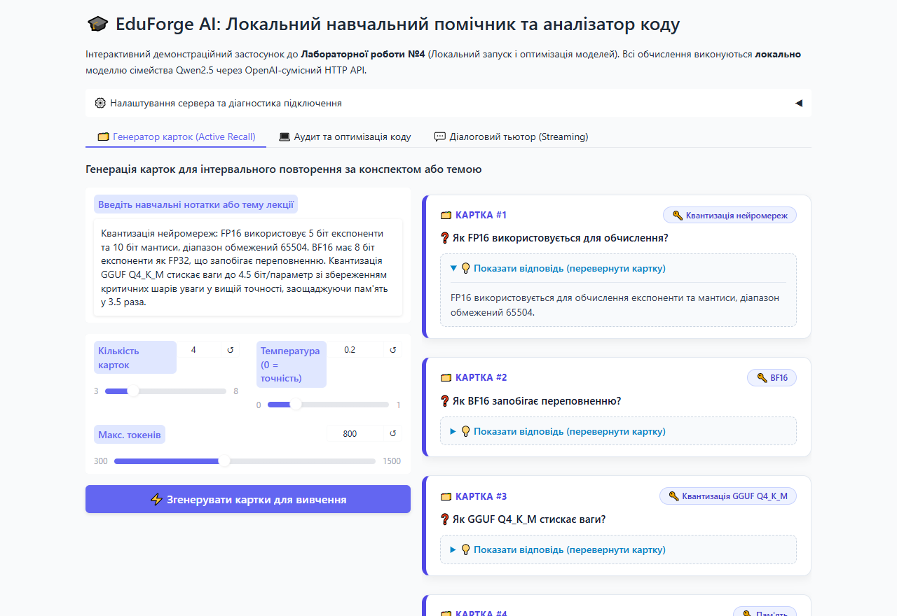
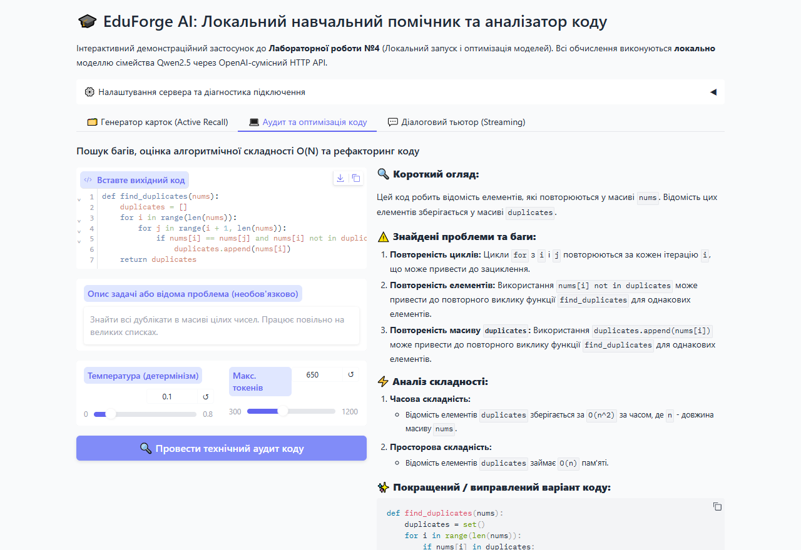
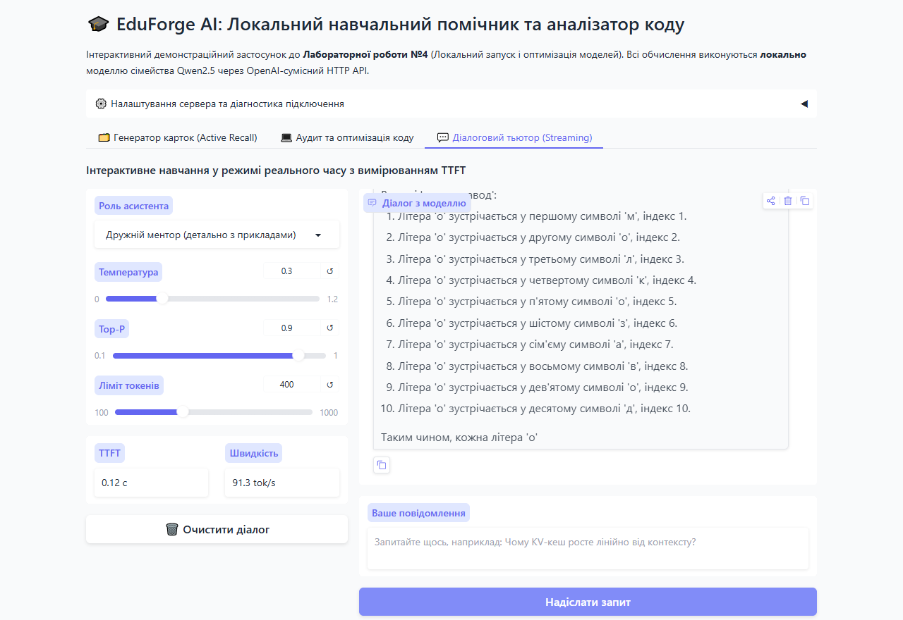
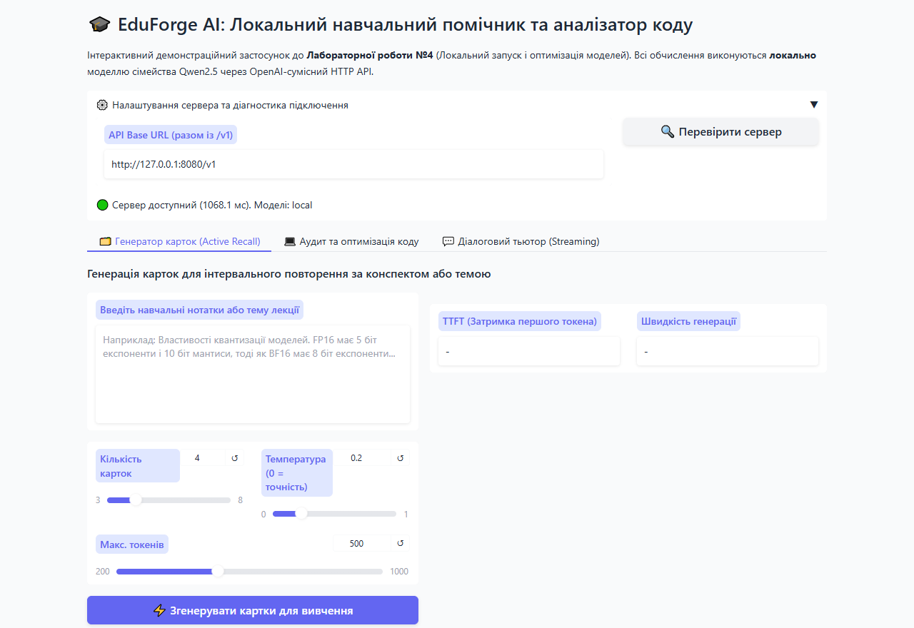

# EduForge AI — Локальний навчальний помічник та аналізатор коду
**Лабораторна робота №4: Локальний запуск і оптимізація моделей**

EduForge AI — це сучасний локальний застосунок на базі мовної моделі `Qwen2.5-1.5B-Instruct` (квантизація `Q4_K_M`), розгорнутої через високопродуктивний рантайм `llama-server` (llama.cpp) з апаратним прискоренням на GPU (NVIDIA GTX 1070).

---

## 🚀 Функціональні можливості

1. **Генератор карток для повторення (Flashcards / Active Recall):**
   - Перетворює конспекти, фрагменти лекцій чи статті на структуровані картки із запитаннями, вичерпними відповідями та ключовими термінами.
2. **Аудит та оптимізація коду (Code Reviewer):**
   - Знаходить приховані баги та крайові випадки (edge cases).
   - Оцінює часову та просторову складність алгоритму за нотацією Big-O ($O(N)$).
   - Пропонує виправлений та оптимізований варіант коду відповідно до стандартів чистого коду (Clean Code / PEP8).
3. **Діалоговий тьютор зі стрімінгом (Interactive Streaming Tutor):**
   - Потоковий вивід токенів (Server-Sent Events) у реальному часі.
   - Вимірювання затримки першого токена (**TTFT**) та поточної швидкості генерації (**tokens/s**).
   - Вибір стилю взаємодії: *Дружній ментор*, *Лаконічний довідник*, *Суворий екзаменатор*.
4. **Діагностика сервера:**
   - Вбудована перевірка доступності OpenAI-сумісного API з інформацією про підключену модель і час відповіді (пінг).

---

## 🛠️ Системні вимоги та встановлення

### 1. Встановлення Python-бібліотек
Переконайтеся, що встановлено Python 3.10+ та необхідні пакети:
```bash
pip install gradio openai
```

### 2. Завантаження моделі
Завантажте ваги моделі `Qwen2.5-1.5B-Instruct` у форматі GGUF (квантизація `Q4_K_M`):
- Посилання на Hugging Face: [Qwen/Qwen2.5-1.5B-Instruct-GGUF](https://huggingface.co/Qwen/Qwen2.5-1.5B-Instruct-GGUF)
- Файл: `qwen2.5-1.5b-instruct-q4_k_m.gguf` (~1.1 GB)
- Збережіть файл у теку `models/` у корені проєкту.

### 3. Запуск рантайму моделі

#### Варіант А (Рекомендований: llama-server з прискоренням GPU):

**Для Git Bash:**
```bash
./llama_server/llama-server.exe -m models/qwen2.5-1.5b-instruct-q4_k_m.gguf --port 8080 --host 127.0.0.1 -ngl 99 -c 4096 -fa on --alias local
```

**Для PowerShell / CMD:**
```powershell
.\llama_server\llama-server.exe -m models\qwen2.5-1.5b-instruct-q4_k_m.gguf --port 8080 --host 127.0.0.1 -ngl 99 -c 4096 -fa on --alias local
```
- `-ngl 99`: вивантаження всіх 28 шарів моделі у VRAM GPU.
- `-c 4096`: розмір контекстного вікна (4096 токенів).
- `-fa on`: увімкнення Flash Attention для економії пам'яті та прискорення.

#### Варіант Б (Через Ollama):
```bash
ollama run qwen2.5:1.5b
```
*(У застосунку в полі налаштувань Base URL вкажіть `http://localhost:11434/v1`)*.

---

## 💻 Запуск веб-застосунку

Перейдіть у теку `lab4/app` і виконайте:
```bash
python app.py
```
Відкрийте веб-браузер за адресою:
👉 **http://127.0.0.1:7860**

---

## 🎯 Обґрунтування параметрів генерації

- **Ліміт токенів (`max_tokens`):**
  - Задано в межах **400–650 токенів** для генерації карток та аналізу коду. Малі моделі без чіткого ліміту схильні до зациклення або надлишкової велемовності. Ліміт гарантує завершеність відповіді та захищає від вичерпання ресурсів.
- **Температура (`temperature`):**
  - **0.1–0.2** для карток та аудиту коду: забезпечує максимальну фактологічну точність, детермінізм та відсутність випадкових вигадок.
  - **0.3–0.5** для діалогового тьютора: додає природності мовленню при збереженні змістовної строгості.
- **Top-P (Nucleus Sampling):**
  - Встановлено **0.9**: відсікає хвіст малоймовірних токенів, запобігаючи генерації незв'язних слів.
- **Довжина контексту (`context_size` = 4096):**
  - Достатня для передачі повних лекційних нотаток або великих функцій коду разом з історією діалогу, займаючи всього ~117 MB у VRAM під KV-кеш.

---

## 📸 Демонстрація інтерфейсу та відео

- **Відеодемонстрація роботи:** [Переглянути відео на Google Drive](https://drive.google.com/file/d/1ETlhAX7cnW0ZEQcSMdZP8G-5Yai2f_SD/view)

| Генератор карток (Active Recall) | Аудит та оптимізація коду |
| :---: | :---: |
|  |  |

| Діалоговий тьютор (Streaming) | Діагностика сервера |
| :---: | :---: |
|  |  |
