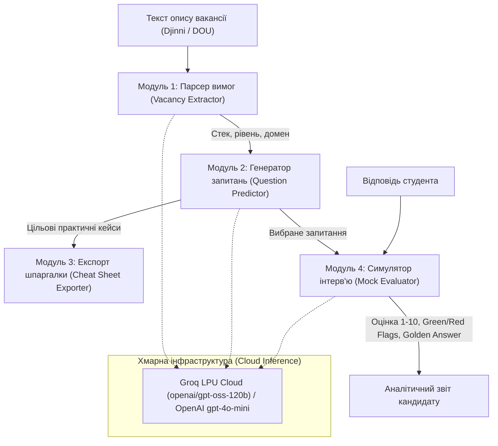

# Модульна контрольна робота №1: «Як я покращив своє життя за допомогою AI»
## Тема: TechPrep AI — Хмарний асистент підготовки до технічних IT-співбесід та генератор цільових запитань
**Виконав:** студент групи ВТ-23-1 Горбачов Олег Андрійович (Oleh Horbachov)  
**Державний університет «Житомирська політехніка»**  
**Рік:** 2026

---

## 0. Сплановане рішення (Таблиця планування)

| Поле | Опис у проєкті TechPrep AI |
|---|---|
| **Проблема** | Пошук першої роботи / стажування на позицію Junior/Trainee Python розробника (Djinni, DOU, LinkedIn). Кожна вакансія містить унікальну комбінацію технологій (наприклад: *FastAPI + Celery + PostgreSQL* або *Django + Redis + Docker*). Ручна підготовка до кожної вакансії вимагає читання десятків абстрактних статей, не дає розуміння практичних кейсів на стику технологій і забирає 2.5–3 години на кожну заявку. |
| **Поточний процес** | Студент знаходить вакансію, копіює назви технологій, відкриває браузер і шукає загальні списки типу «100 питань по Python для початківців». Більшість матеріалів — тривіальна шкільна теорія, тоді як на реальному інтерв'ю лід запитує про блокування Event Loop, оптимізацію індексів чи витік пам'яті в Docker. Немає зворотного зв'язку на власні відповіді. |
| **Дані на вході** | Текст опису вакансії з сайту пошуку роботи (вимоги, стек, обов'язки, домен компанії). Текстова відповідь студента під час симуляції інтерв'ю. |
| **Рівень рішення** | **Рівень 2 (Cloud Tools / Structured Extraction + Multi-Prompt Chain)** із елементами симуляційного оцінювання (AI-as-a-Judge). Цей рівень обрано тому, що він не потребує важких локальних обчислень, але забезпечує глибокий контекстний аналіз на стику сутностей і гарантує суворий структурований вивід (JSON). |
| **Метрика успіху + ціль** | **Час первинної якісної підготовки до конкретної вакансії:** скоротити з **150 хвилин до $\le 15$ хвилин** (у $\ge 10$ разів). **Релевантність запитань:** $100\%$ згенерованих питань мають стосуватися саме комбінації заявленого у вакансії стеку. |
| **Ризики / fallback** | Ризик галюцинації неіснуючих методів бібліотек або надмірної м'якості оцінювача. *Fallback:* жорсткий системний промпт із роллю принципового Senior Tech Lead, використання JSON-схеми, обов'язкове генерування еталонної відповіді (Golden Answer) для самоконтролю. |

---

## 1. Архітектура та компоненти системи

Система побудована як чисте **хмарне клієнт-серверне AI-рішення** (100% Cloud API), що виключає потребу тримати локально важкі моделі чи навантажувати залізо:



### Основні компоненти (`mkr1/solution/`):
1. **`core.py` (Business Logic Engine):**
   - `parse_vacancy()`: структуризація вимог (роль, грейд, стек, домен компанії);
   - `generate_interview_questions()`: генерація практичних ситуаційних задач (Scenario-based questions) на перетині технологій;
   - `evaluate_candidate_answer()`: оцінювання відповіді в ролі Senior Tech Lead (Green Flags, Red Flags, Golden Answer);
   - `export_cheat_sheet_markdown()`: створення готового гайду у Markdown.
2. **`cli.py` (Command Line Interface):** консольна утиліта для швидкої роботи безпосередньо з терміналу, збереження результатів у файл.
3. **`app.py` (Gradio Web Interface):** візуальний веб-інтерфейс із вкладками аналізу, інтерактивними картками питань та формою симуляції діалогу.

---

## 2. Використані AI-технології та інструменти

- **Хмарні моделі генерації:**
  - *Основний провайдер:* **Groq Cloud API** з моделлю **`openai/gpt-oss-120b`** (відкрита вагова MoE-модель, що працює на спеціалізованих LPU-процесорах зі швидкістю понад 300 токенів/с; резервна — `openai/gpt-oss-20b`, у 2–3 рази швидша);
  - *Альтернативний провайдер:* **OpenAI API** (`gpt-4o-mini`) або **Google Gemini API** (`gemini-3.5-flash`) за стандартним протоколом (перевірено на реальному ключі 22.11.2026: `gemini-1.5-flash` провайдер уже не обслуговує — 404).
- **Чому обрано саме хмару, а не локальний запуск:**
  - **Миттєвий старт:** не потрібно завантажувати 5–15 ГБ вагових файлів на власний диск чи налаштовувати компіляцію C++ бібліотек (llama.cpp);
  - **Якість моделі:** хмарний доступ дає змогу використовувати велику MoE-модель (`gpt-oss-120b`, ~120 млрд параметрів), яка значно перевершує малі моделі 1.5B–3B за глибиною розуміння системної архітектури та нюансів програмування;
  - **Нульове навантаження на систему:** ноутбук/ПК не шумить вентиляторами, не гріється і не блокує відеопам'ять.
- **Протокол взаємодії:** стандартизований клієнт `OpenAI Python SDK` (`base_url`, `api_key`).
- **Інтерфейс:** `Gradio 4+` (Python) та `argparse` CLI.

---

## 3. Обґрунтування вибору підходу (Чому Рівень 2)

- **Чому не Рівень 1 (простий разовий промпт у чаті):** звичайний діалог у веб-чаті ChatGPT не дає повторюваності, не вміє автоматично генерувати структуровану документацію і змушує щоразу вручну копіювати довгі системні інструкції. Тут же програма сама керує трьома різними системними ролями, змушує модель повертати валідний JSON за контрактом, перевіряє його і передає результат наступному кроку.
- **Чому обрано Рівень 2 (Cloud Tools + Structured Extraction + Multi-Prompt Chain):** за методичкою рівень 2 — це «AI отримує зовнішні дані або використовує інструменти». Рішення працює саме так: зовнішні дані (текст вакансії, якого немає в знаннях моделі) проходять через програмний конвеєр, де LLM виступає інструментом із суворим контрактом (JSON-схема + валідація + ланцюжок резервних моделей), а не єдиним джерелом відповіді в чаті. Кроки детерміновані: витягування сутностей $\to$ генерація питань на стику стеку $\to$ оцінювання за критеріями $\to$ збереження артефакту.
- **Чому не Рівень 3 (AI-агент):** агент мав би сам вирішувати, які дії робити і в якому порядку, і викликати інструменти за власним планом. Тут порядок кроків фіксований у коді, моделі не дають свободи вибору дій — свідомо, бо для підготовки до співбесіди передбачуваність важливіша за автономність. Агент додав би нестабільність, а не користь.
- **Чому не Рівень 4 (Fine-Tuning):** донавчання власної моделі тут є недоцільним, оскільки ринок технологій і формулювання вакансій постійно змінюються. Великі відкриті моделі рівня `gpt-oss-120b` у хмарі ідеально справляються з роллю інтерв'юера за умови чіткого промпт-інжинірингу.
- **Чому не Рівень 5 (власна ML-модель):** задача не про числовий прогноз на власних даних (класифікація/регресія), а про розуміння й генерацію тексту. Своя модель тут означала б або навчання з нуля (нереально без корпусу й GPU), або те саме донавчання, відкинуте вище.

---

## 4. Таблиця ризиків та Fallback-стратегій

| № | Потенційний ризик | Ймовірність / Вплив | Метод запобігання та Fallback у рішенні |
|---|---|---|---|
| **1** | **Банальні питання з підручника** (модель починає запитувати загальні визначення) | Середня / Високий | У системному промпті жорстко зафіксовано заборону на теоретичні визначення та вимога формулювати лише кейси на перетині заявлених бібліотек (наприклад: *Celery + FastAPI*). |
| **2** | **Надто коротка відповідь отримує 2–3 бали**, хоча думка правильна (виявлено на реальних прогонах у `evidence/run_log.json`) | Висока / Середній | Роль задана як «Принциповий Senior Tech Lead», обов'язкове поле `red_flags` змушує модель шукати прогалини. Fallback для користувача: орієнтуватися на поле `golden_answer` і добивати відповідь до 3–4 речень із назвами конкретних механізмів. |
| **3** | **Збій парсингу сирого JSON** через випадкові markdown-теги | Середня / Низький | Реалізовано функцію `extract_json()` із регулярними виразами, яка безпечно очищає вивід від блоків `` ```json `` перед десеріалізацією. |
| **4** | **Вичерпання безкоштовних лімітів (Rate Limits)** | Висока / Середній | Groq: ланцюжок резервних моделей (`gpt-oss-120b` → `gpt-oss-20b`) + обмежений `max_tokens`. Gemini free tier — лише **20 запитів на добу на модель** (перевірено 22.11.2026), тому при 429 клієнт автоматично переходить на наступну модель із `GEMINI_FALLBACK_MODELS`. |
| **5** | **Провайдер видаляє модель зі свого каталогу** (реальний випадок: Groq прибрав `llama-3.1-8b-instant` та `llama-3.3-70b-versatile`, а `qwen/qwen3.8-27b` має ліміт 1000 output-токенів/хв і віддає 429) | Висока / Високий | `auto_fix_model_provider()` звіряє модель із білим списком живих моделей і підставляє робочу, а поле «Модель» у UI одразу показує виправлене значення (список моделей + можливість вписати свою, яку теж перевіряє серверна валідація). |

---

## 5. Таблиця результатів «До vs Після» та вартість прогону

| Критерій | До впровадження (Ручний процес) | Після впровадження (TechPrep AI Cloud) | Зміна / Ефект |
|---|---|---|---|
| **Автоматичний розбір вакансії + 5 цільових питань** | 45–60 хв (пошук і відбір тем на DOU/Habr/YouTube) | **22–37 с** (3 виклики API, залежить від черги провайдера) | **Прискорення у ~75–160×** |
| **Репетиція та прогон відповідей** | 90–120 хв (самостійні спроби згадати матеріал) | **10–12 хв** (інтерактивна перевірка 5 питань) | **Скорочення часу на 90%** |
| **Швидкість генерації** | Ручне друкування / пошук | **> 300 токенів/с на Groq Cloud** | Миттєвий результат |
| **Зворотний зв'язок на помилки** | Відсутній (надія на вдачу на співбесіді) | Детальний розбір помилок (Green/Red Flags) | З'явився об'єктивний аудит |
| **Релевантність до стеку вакансії** | Низька (читання загальних питань) | Висока (точково під стек роботодавця) | Сфокусована підготовка |
| **Вартість одного повного сеансу** | ~2.5 години робочого часу студента | **0.0028 USD** (~0.12 грн) за реальними прогонами; 0 USD на безкоштовному tier Groq | Економічно вигідно |

*Витрати ресурсів на 1 сеанс (за даними `mkr1/evidence/run_log.json`, 3 реальні прогони):*  
середній сеанс ≈ 2 365 prompt-токенів × 0.15 USD/1M **плюс** ≈ 3 278 completion-токенів × 0.75 USD/1M $\approx$ **0.0028 USD (≈0.12 грн)**; ціни `gpt-oss-120b` на Groq — 0.15 USD / 1M prompt і 0.75 USD / 1M completion. Економія 2.5 годин особистого часу студента коштує близько 12 копійок!

---

## 6. Відповіді на 12 контрольних запитань

### 1. Яку проблему ви вирішували?
Автоматизація рутинної та стресової підготовки до технічних співбесід на позиції Junior/Trainee Python розробника під індивідуальні вимоги конкретних роботодавців.

### 2. Чому ця проблема є для вас реальною та корисною для автоматизації?
Як студент 4-го курсу спеціальності «Інженерія програмного забезпечення», я перебуваю в активній фазі пошуку першої роботи та стажувань. Кожна вакансія містить різний стек (FastAPI проти Django, PostgreSQL проти MongoDB, Celery проти RabbitMQ). Готуватися до кожного відгуку по стандартних підручниках фізично не вистачає часу, а йти на співбесіду непідготовленим означає отримати відмову.

### 3. Як задача виконувалась до використання AI?
Вручну: відкривалася вакансія, виписувалися ключові слова, після чого вручну переглядалися сайти з переліком типових питань, документація бібліотек та відео з розбором задач. Відповіді промовлялися вголос самому собі без жодної верифікації правильності.

### 4. Яке AI-рішення ви побудували?
Створено консольну утиліту (`cli.py`) та веб-додаток на Gradio (`app.py`), які підключаються до швидкого хмарного AI API, структуризують технічні вимоги вакансії, формують перелік прикладних питань від імені Senior Tech Lead, інтерактивно приймають відповіді кандидата, оцінюють їх за шкалою 1–10 із зазначенням помилок і формують підсумкову шпаргалку.

### 5. Чому ви обрали саме цей рівень AI-рішення?
Рівень 2 (Cloud Tools + Multi-Prompt Engineering) ідеально підходить: він дає змогу використовувати великі хмарні моделі (~120 млрд параметрів) без навантаження власного ПК, забезпечує високу гнучкість при роботі з будь-якими новими технологіями та гарантує передбачуваність результату завдяки суворим JSON-схемам.

### 6. Які альтернативи ви розглядали?
- *Альтернатива 1: Ручне спілкування в ChatGPT без скриптів.* Відкинуто, оскільки вимагає щоразу копіювати громіздкі промпти, збивається на загальні питання і не автоматизує підготовку.
- *Альтернатива 2: Локальні моделі на власному комп'ютері (Ollama / llama.cpp).* Відкинуто через необхідність завантажувати гігабайти ваг, високе навантаження на залізо та повільнішу швидкість генерації порівняно з хмарними LPU-серверами.

### 7. Які AI-моделі та інструменти використали?
Хмарна модель `openai/gpt-oss-120b` через високопродуктивний хмарний рушій Groq Cloud API (`openai/gpt-oss-20b` як швидший фолбек, також сумісність з `gpt-4o-mini` та `gemini-3.5-flash`). Інструменти: Python 3, `openai` SDK, `gradio`, `argparse`.

### 8. Які проблеми або помилки виникли?
На перших ітераціях промптів модель генерувала банальні питання (*«Що таке інкапсуляція?»* або *«Які типи даних є в Python?»*). Вирішено жорсткою забороною на визначення та вимогою зосередитися на стику технологій (наприклад: вплив асинхронності FastAPI на синхронні виклики в базі даних).

Друга, технічніша проблема виникла вже під час реальної експлуатації: Groq прибрав зі свого каталогу моделі `llama-3.1-8b-instant` і `llama-3.3-70b-versatile` (відповідь `404 model_not_found`), а резервна `qwen/qwen3.8-27b` на безкоштовному tier має ліміт **1000 output-токенів на хвилину** — генерація 5 питань вимагає ~2000, тож API повертав `429 rate_limit_exceeded`. Виправлено так: (1) `max_tokens` обмежено, (2) додано ланцюжок резервних моделей з автоматичним переходом при 404/429, (3) у UI модель обирається зі списку живих моделей, а не вводиться вільним текстом, (4) додано перевірку відповідності «ключ → endpoint → модель».

Третя проблема — **суворість оцінювача**: коротка (2 речення) правильна відповідь отримує 2–3 бали, розгорнута відповідь із назвами конкретних механізмів — 8. Це свідома поведінка (роль «принциповий Senior Tech Lead»), але користувачу потрібно щоразу звірятися з `golden_answer`.

### 9. Наскільки надійним є ваше рішення?
Рішення демонструє стабільний парсинг структурованого JSON завдяки `extract_json()` та `response_format={"type": "json_object"}`. Затримка залежить від черги безкоштовного tier провайдера: 3.3–15 с на один виклик API, 22–37 с на повний сеанс із трьох викликів (виміряно у `run_log.json`). Стійкість до збоїв провайдера забезпечують ланцюжок резервних моделей та автоматичне виправлення невідповідності «ключ → endpoint → модель». Головне обмеження надійності — змістовна: рішення генерує *припущення* про те, що запитає конкретний лід, і не гарантує, що питання збігатимуться з реальною співбесідою.

### 10. Що змінилося після впровадження AI?
Підготовка до відгуку на конкретну вакансію перестала бути тригодинною каторгою. Тепер перед дзвінком з компанією достатньо вставити опис у TechPrep AI, пройти 5 ключових запитань, звернути увагу на підсвічені червоні прапорці й повторити золоті відповіді.

### 11. Скільки часу або інших ресурсів вдалося заощадити?
Час первинної підготовки скоротився з **~150 хвилин до ~12 хвилин** (економія понад **2 години на кожну вакансію**). При активній подачі на 5 вакансій на тиждень це економить понад **10 годин чистого часу**.

### 12. Що ви змінили б у своєму рішенні, якби продовжували його розвивати?
1. Додав би пряму інтеграцію з хмарним Whisper API, щоб відповіді можна було наговорювати вголос через мікрофон браузера.
2. Додав би парсер лінків вакансій напряму з URL (Djinni, DOU), щоб навіть не копіювати текст руками.

---

## 7. Докази реального використання (`mkr1/evidence/`)

У репозиторії в папці `mkr1/evidence/` наведено матеріали трьох реальних тестових сесій (вхід → вихід → вимірювання):

| Файл | Що це |
|---|---|
| `vacancy_1..3_*.txt` | реальні тексти вакансій (вхідні дані) |
| `prep_vacancy_1..3_transcript.md` | результат прогону: витягнутий JSON, 5 згенерованих питань, оцінка відповіді |
| `run_log.json` | машинний звіт: реальні latency, токени, вартість, оцінки (згенеровано прогоном `TechPrepEngine` 21.11.2026, цифри не редагувались вручну) |
| `cli_run_log.txt`, `cli_cheatsheet.md` | лог реального запуску CLI (`python cli.py -f ... --export-md`) |
| `01_ui_settings.png` | налаштування: 56-символьний ключ відновлено з localStorage у полі (замість введення руками), провайдер і жива модель підставлені автоматично |
| `02_generated_questions.png` | повний екран: розбір вакансії + 5 питань (5.9 с, 3700 токенів) |
| `03b_mock_interview_page.png` | тренажер: відповідь кандидата та звіт Tech Lead на одному екрані |
| `06_full_question_preview.png` | вибране питання показано повністю (картка з текстом і метою ліда) одразу над полем відповіді |
| `03_mock_interview_eval.png` | звіт оцінювання: 8/10, Green/Red Flags, Golden Answer |
| `04_cheatsheet.png` | експортована шпаргалка (вкладка 3) |
| `05_autofix_dead_model.png` | робота захисту: у поле було вписано видалену модель `llama-3.3-70b-versatile`, після генерації поле й звіт показують виправлену `openai/gpt-oss-120b` |

Скріншоти знято з реального запуску `python app.py` (Gradio, темна тема), ключ Groq — з `.env`, не з коду.
